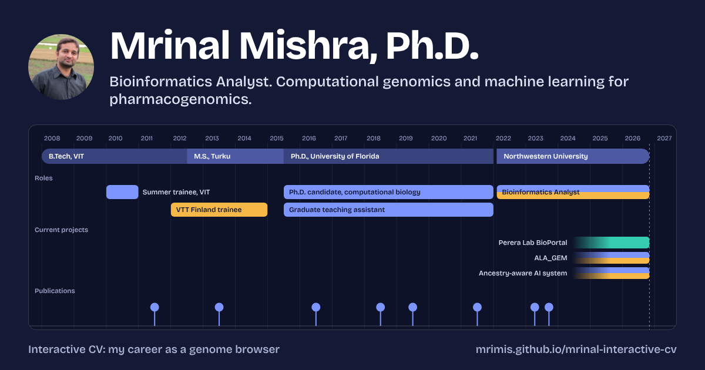

# Mrinal Mishra Interactive CV

Live site: [https://mrimis.github.io/mrinal-interactive-cv/](https://mrimis.github.io/mrinal-interactive-cv/)

GitHub profile share page: [https://mrimis.github.io/mrinal-interactive-cv/github.html](https://mrimis.github.io/mrinal-interactive-cv/github.html)

Open `index.html` in a browser to view the CV. It is a single scrolling page: current work, experience, publications, skills, code, credentials, and contact.

The top of the page is a career genome browser. The axis is time. Tracks show education and employer bands, roles, current projects, publications, and awards. You can pan, zoom, and select a feature to read it. The features are listed in the `FEATURES` array at the top of `app.js`. Edit that array to add a role, paper, or award.

Three colors stand for the three threads of work (genomics, machine learning, software). Picking one highlights matching features and entries. Each entry is tagged in `index.html` with `data-t="g m e"`.

The site is static and self-contained: `index.html`, `styles.css`, `app.js`, fonts in `assets/fonts/`, and the PDF and ATS DOCX files in `downloads/`.

The confidential AI-system project is intentionally described only at a public, high-level level. Do not add architecture, implementation, unpublished methods, or patent-sensitive details before sharing publicly.
